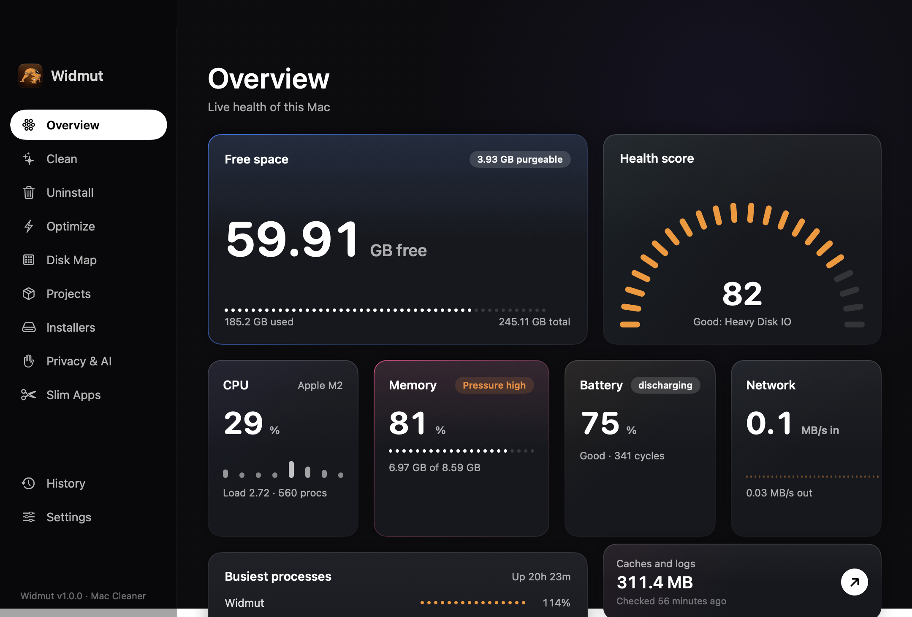

<div align="center">


# Widmut

**The modern, powerful, and private Mac cleaner.**  
A fast, native macOS application designed to clean caches, uninstall apps with all leftovers, visualize and manage disk space, optimize performance, and protect your privacy.

[](LICENSE)
[](#install)
[](#build)

<br/>



</div>

---

## Highlights

* **100% Free & Open Source:** Full GPL-3.0 license. No subscriptions, no ads, no telemetry, no tracking.
* **Modern Pro Obsidian Design:** Solid dark surfaces with Solar Amber accents built entirely with native SwiftUI and SF Pro typography.
* **Safety First:** Actions default to Trash so you can easily restore anything. Critical macOS and application directories are strictly protected.
* **Next-Level Disk Map:** Interactive visual breakdown of your drives with one-click cleanup for caches, developer artifacts, and old downloads, plus multi-select batch deletion.
* **App Uninstaller & Leftover Cleaner:** Completely remove applications alongside their hidden Application Support, cache, and preference files.
* **Apple Intelligence Manager:** Detect, inspect, and purge on-device AI model weights to instantly reclaim gigabytes of storage.
* **Developer Project Purge:** Safely reclaim space from `node_modules`, `.next`, `dist`, `target`, `.venv`, and build artifacts across your repositories.
* **Live System Monitor:** Real-time menu bar and dashboard monitor for CPU, memory pressure, battery, network, and disk usage.

---

## Features

| Feature | Description |
|---|---|
| **Overview** | Real-time Mac vitals: CPU load, memory pressure, network throughput, battery health, and quick actions |
| **Clean** | Scan and preview system and user caches, log files, and temporary data with one-click safe cleaning |
| **Uninstall** | Comprehensive app catalog sorted by size or name with leftovers detection for already-deleted apps |
| **Optimize** | One-click maintenance routines: DNS flush, Spotlight re-index, RAM release, and preference repairs |
| **Disk Map** | High-performance space visualizer with direct "Clean" actions, bulk deletion, and Finder reveals |
| **Projects** | Find and clear bloated build caches across development projects (`node_modules`, `target`, `.venv`) |
| **Installers** | Locate forgotten `.dmg`, `.pkg`, `.iso`, and `.xip` files taking up valuable disk space |
| **Privacy & AI** | Toggle 27 system privacy settings, and inspect or purge Apple Intelligence / on-device AI models |
| **Slim Apps** | Strip unused Intel architectures from universal binary applications on Apple Silicon |
| **History** | Searchable audit trail of all actions and reclaimed disk space |
| **Menu Bar Tray** | Discreet, lightweight status monitor with quick actions right from your menu bar |

---

## Keyboard Shortcuts

| Shortcut | Action |
|---|---|
| <kbd>⌘</kbd> <kbd>1</kbd> … <kbd>⌘</kbd> <kbd>9</kbd>, <kbd>⌘</kbd> <kbd>0</kbd>, <kbd>⌘</kbd> <kbd>,</kbd> | Jump directly to any page |
| <kbd>⌘</kbd> <kbd>R</kbd> | Rescan or stop current scan |
| <kbd>⌘</kbd> <kbd>F</kbd> | Search applications in Uninstall |
| <kbd>Esc</kbd> | Clear current selection |
| <kbd>Return</kbd> | Confirm selected action |

---

## Installation

### Requirements
* macOS 14.0 or later
* Apple Silicon (M1, M2, M3, M4)

### Building from Source

Widmut requires only the standard Swift toolchain and command-line tools:

```bash
# Clone the repository
git clone https://github.com/VedasarathiV/widmut.git
cd widmut

# Run the test suite
swift test

# Build and bundle the application
./scripts/bundle.sh

# Install to Applications
cp -R build/Widmut.app /Applications/Widmut.app
xattr -cr /Applications/Widmut.app
```

---

## License

Widmut is free software licensed under the **GNU General Public License v3.0** ([GPL-3.0](LICENSE)).
